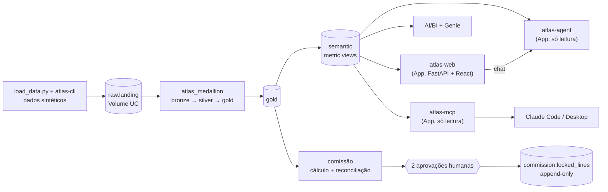

# Atlas Recarga

**Descubra onde a recarga pré-paga acontece no Brasil, feche a comissão de canal com duas aprovações humanas e pergunte ao dado em linguagem natural, com cada número rastreável até uma única definição.** Plataforma de dados e IA no **Databricks Free Edition** para a rede de recarga da **Eaí? Telecom** (empresa fictícia; dados 100% sintéticos).

[](https://github.com/AndreFelippeVidal/atlas-recarga/actions/workflows/ci.yml)


**Demo ao vivo:** _ainda não publicada_ (os Apps da Free Edition param a cada 24 h; veja o [runbook](#runbook-de-demo-religar-os-3-apps)) · **Captura da demo:** _placeholder_ · [Arquitetura](docs/architecture.md) · [PRD](docs/prd.md) · [Roadmap](docs/specs/roadmap.md)

Construído por **Spec-Driven Development**: cada pedaço nasceu de uma [spec](docs/specs/README.md) e de [ADRs](docs/adr/README.md) com as alternativas descartadas.

---

## 1. Comece pelos dados: gerar um intervalo e carregar na landing

Tudo parte de **um comando** que gera dados sintéticos determinísticos para um intervalo de datas, envia para a landing (`/Volumes/<catálogo>/raw/landing/`) e roda o pipeline medalhão ([SPEC-012](docs/specs/012-data-range-loader/spec.md)):

```bash
uv run python scripts/load_data.py --from 2026-08-01 --to 2026-10-31 --profile $PROFILE --dry-run   # só o plano
uv run python scripts/load_data.py --from 2026-08-01 --to 2026-10-31 --profile $PROFILE             # gera, valida, sobe e roda o atlas_daily
```

| Flag | Padrão | O que faz |
|---|---|---|
| `--from`, `--to` | obrigatórias | Dias do intervalo, inclusivos (`YYYY-MM-DD`, até 366 dias) |
| `--profile` | obrigatória | Perfil do Databricks CLI (o script nunca escolhe um sozinho) |
| `--target` | `dev` | `dev` (catálogo `atlas_dev`) ou `demo` (catálogo `atlas`) |
| `--seed`, `--rows` | `42`, `2000000` | Mesma seed e mesmas flags geram os mesmos bytes |
| `--base-end-month`, `--base-months` | `2026-11`, `12` | Janela base **fixa**: PDVs e distribuidores dependem dela |
| `--no-run` | desligado | Gera, valida e sobe, mas não dispara o `atlas_daily` |

O que o script faz: gera a janela base com o `atlas-cli`; gera com `--incremental-day` os dias que ficam fora dela; **poda** as partições fora de `[from, to]`; roda o `validate`; confere que `pos` e `distributors` são os já carregados (senão aborta); envia (`upload` idempotente, nunca apaga); e roda `bundle run atlas_daily`. Cenários de vários dias (queda regional, duplicatas, chegada tardia) só aparecem se o dia deles estiver no intervalo. O gerador também funciona sozinho: `uv run atlas-cli --help` ([SPEC-001](docs/specs/001-synthetic-data-cli/spec.md)).

### Antes da primeira carga (uma vez por workspace)

```bash
# Pré-requisitos: Databricks Free Edition, Databricks CLI >= 0.260, uv, Python 3.12
databricks auth login --profile <perfil>        # ou um perfil existente em ~/.databrickscfg
export PROFILE=<perfil>
export WAREHOUSE_ID=<id do SQL warehouse>       # databricks warehouses list --profile $PROFILE

uv sync                                          # ambiente Python 3.12 + ferramentas
```

Ajuste em `databricks.yml` (targets `dev` e `demo`) o `warehouse_id` e o `agent_url` do seu workspace. Leitores por principal (e-mails, service principals) vão em `databricks.local.yml`, fora do git (modelo em `databricks.example-local.yml`).

```bash
# 1) catálogo, grupos e membros (o bundle não declara catálogo nem grupos; ADR-0017)
uv run python scripts/setup_workspace.py --target dev --profile $PROFILE --dry-run
uv run python scripts/setup_workspace.py --target dev --profile $PROFILE

# 2) schemas, Volume, pipeline, jobs, dashboards e Apps (o Genie pode falhar: as metric views ainda não existem)
databricks bundle validate -t dev --profile $PROFILE
databricks bundle deploy   -t dev --profile $PROFILE
```

Agora rode o `load_data.py` acima. O 1º `atlas_daily` leva ~3 min; `freshness=stale` é esperado enquanto os dados terminam em 2026-10-31.

---

## 2. Subir o resto (na ordem)

```bash
# 2.1 Camada semântica: metric views + UC functions do agente; depois o deploy do Genie, que as referencia
databricks bundle run    atlas_semantic_deploy -t dev --profile $PROFILE
databricks bundle deploy -t dev --profile $PROFILE

# 2.2 Comissão: tabelas (uma vez) e rascunho do mês anterior com reconciliação independente
databricks bundle run atlas_commission_deploy -t dev --profile $PROFILE
databricks bundle run atlas_commission_draft  -t dev --profile $PROFILE

# 2.3 Golden set do agente para o dataset MLflow
databricks bundle run atlas_eval_sync -t dev --profile $PROFILE

# 2.4 Os 3 Apps (o deploy só cria o App; o código sobe no `run`)
databricks bundle run agent_atlas -t dev --profile $PROFILE
databricks bundle run atlas_mcp   -t dev --profile $PROFILE
databricks bundle run atlas_web   -t dev --profile $PROFILE
make apps-start PROFILE=$PROFILE                 # confere os healthchecks dos 3
```

**A aprovação da comissão é humana.** O rascunho `COM-AAAA-MM-v1` nasce em `draft`. Quem decide dispara o job `atlas_commission_review` pelo workspace (*Run now with different parameters*: `batch_id`, `decision` = `submit` | `approve` | `reject`, `justification`), uma transição por execução, em duas etapas (analista e diretora); a segunda trava o lote e grava a remessa. Nenhum agente de código executa esse job ([ADR-0010](docs/adr/0010-commission-human-in-the-loop.md), [commission/README.md](commission/README.md)).

**Observabilidade (opcional).** Tabelas de traces do agente e do MCP, e o monitoramento diário dos traces:

```bash
uv run --project apps/agent python scripts/setup_agent_trace_tables.py --profile $PROFILE --catalog atlas_dev \
    --warehouse-id $WAREHOUSE_ID --experiment-id <atlas_agent_traces> --app-sp <client_id do agent-atlas> --apply
uv run --project apps/mcp python scripts/setup_mcp_trace_tables.py --profile $PROFILE --catalog atlas_dev \
    --warehouse-id $WAREHOUSE_ID --experiment-id <atlas_mcp_traces> --app-sp <client_id do atlas-mcp> --apply
databricks bundle run atlas_agent_monitoring -t dev --profile $PROFILE
```

**Demo (catálogo `atlas`).** Troque `-t dev` por `-t demo` e `--target dev` por `--target demo`. O `bundle deploy -t demo` é sempre feito por você, não pelo agente de código.

### Conferir que está tudo em pé

```bash
uv run python scripts/check_consistency.py --profile $PROFILE --warehouse-id $WAREHOUSE_ID --catalog atlas_dev   # mesmo gross_revenue nos 5 consumidores
uv run python scripts/check_mv_recharges.py --target dev --profile $PROFILE --warehouse-id $WAREHOUSE_ID         # as 7 medidas respondem
uv run python scripts/check_web_kpis.py                                                                          # KPIs do dashboard = gold (veja o cabeçalho do script)
```

Cada pasta tem checagens próprias em `scripts/check_*.py` (resumo em [scripts/README.md](scripts/README.md)).

---

## 3. Por que existe

A Helena, diretora comercial da Eaí? Telecom, fecha a comissão de canal em cerca de 3 dias, em planilhas, e uma pergunta ad hoc leva dias. O Atlas mostra a recarga no mapa, fecha a comissão com cálculo determinístico, reconciliação independente e **duas aprovações humanas**, e responde perguntas de negócio com a fonte de cada número. Problema, personas e escopo: [Discovery](docs/discovery.md) e [PRD](docs/prd.md).

Os nove princípios inegociáveis estão na [mission](docs/specs/mission.md). Os dois que moldam tudo: **uma só definição de cada métrica** (consumidores leem apenas `atlas.semantic`) e **IA nunca calcula nem aprova comissão**.

## 4. Arquitetura



Diagrama C4 completo, onde ficam os dados, as fronteiras do humano e da IA e a tabela de modos de falha: [docs/architecture.md](docs/architecture.md).

## 5. Stack

| Camada | Ferramenta | Por quê |
|---|---|---|
| Plataforma | Databricks Free Edition (serverless), Unity Catalog | Governança e linhagem de bronze até a metric view, sem custo |
| Deploy | Declarative Automation Bundles + CLI | Catálogo, pipeline, jobs e Apps reproduzíveis por `bundle deploy` |
| Dados sintéticos | Python 3.12, Typer, NumPy, PyArrow | Seed determinística: mesmos bytes, mesmo dataset |
| Pipeline | Lakeflow Spark Declarative Pipelines + Auto Loader | Medalhão com expectations e linhagem |
| Semântica | UC metric views (YAML) | Definição única de cada métrica, com `MEASURE()` |
| BI | AI/BI Dashboards, Genie Space | Só sobre metric views |
| Agente | LangGraph + Mosaic AI Agent Framework, Unity Gateway | Somente leitura, citação de fonte, traces no MLflow |
| Avaliação | MLflow 3 GenAI, golden set | Acurácia medida e gate no CI |
| MCP | FastMCP (Streamable HTTP) | Mesmas métricas no Claude, com lista fechada e parâmetros vinculados |
| Web | FastAPI, React, TypeScript, Vite, d3-geo | Mapa coroplético UF → município |
| Qualidade | uv, ruff, mypy, pytest, gitleaks, pre-commit | O mesmo conjunto local e no CI |

Versões mínimas, convenções e a lista **Proibido**: [tech-stack.md](docs/specs/tech-stack.md).

## 6. Métricas medidas (PRD §4)

Medidas no `dev` pelo mantenedor; cada linha aponta para a task que a mediu no [roadmap](docs/specs/roadmap.md).

| Métrica | Meta | Medido | Task |
|---|---|---|---|
| Acurácia do agente no golden set | ≥ 90% | 93,5 / 90,3 / 90,3% em 3 rodadas (média 91,4%); só scorers de código, sem LLM judges | P10.6 |
| Recusa fora do escopo | 100% | Sem falha de recusa no golden set | P10.6 |
| Divergência da comissão × reconciliação | R$ 0,00 | R$ 0,00 em 4.798 linhas (`COM-2026-10-v1`) | P8.4 |
| Gold D-1 | até 08:00 | `atlas_daily` em ~3 min (run manual); o disparo das 06:00 não foi observado | P6.7 |
| Dashboard React | p95 < 3 s | p95 1.457 ms a frio; 484 ms após stop e start | P12.8, P12.14 |
| Consistência entre consumidores | 100% | `gross_revenue` de 2026-10 igual (R$ 4.122.460,00) em AI/BI, Genie, agente, MCP e React; MCP × golden set: 20 casos de métrica iguais ao SQL de referência | P13.2, P11.4 |
| Lotes `locked` com 2 aprovações | 100% | Lotes travados, mas **um único ator** no workspace: a 2ª etapa usou `demo_override` (`demo_mode = true`) | P8.9 |
| Agente p95 < 15 s, fechamento < 1 h, pergunta < 1 min | — | **Não medidos** | — |

## 7. O que aprendi

> _Rascunho a confirmar pelo autor: reflete o que o repositório registra, mas cabe a quem construiu dizer o que aprendeu._

- **O gargalo estava na conexão, não no banco.** O dashboard demorava ~3,4 s por consulta porque abria uma conexão nova a cada uma; reaproveitá-la levou o p50 a 343 ms. O Lakebase foi testado e descartado ([ADR-0022](docs/adr/0022-dashboard-read-path-connection-reuse.md)).
- **A Free Edition não tem tudo que o desenho previa.** O gateway não oferece guardrail de PII nem teto mensal que bloqueie, então a PII é mascarada no App ([ADR-0021](docs/adr/0021-agent-gateway-limits-and-pii-fallback.md)). O production monitoring do MLflow (Beta) não anexou nenhuma avaliação aos traces, e o plano B (job com scorers de código) é o que vale ([ADR-0013](docs/adr/0013-mlflow-genai-evaluation-monitoring.md)).
- **Determinismo tem dependências escondidas.** Os PDVs dependem da janela do gerador; mudar a janela deixaria as recargas já carregadas órfãs. Por isso o `load_data.py` fixa a janela base e recusa subir PDVs diferentes dos já enviados.
- **Spec primeiro evita retrabalho, mas mente se ninguém executa.** Cada task só foi marcada depois de conferida no workspace, e o que ficou sem conferir está escrito no roadmap.

## 8. Perguntar ao Atlas pelo Claude (MCP)

O App `atlas-mcp` expõe as metric views como tools MCP somente leitura. No Claude Code:
```bash
claude mcp add --transport http atlas https://<atlas-mcp-app-host>/mcp \
  --header "Authorization: Bearer $DATABRICKS_USER_TOKEN"   # token de curta duração do seu usuário
```
Depois: *"Qual a receita bruta de outubro de 2026?"* → R$ 4.122.460,00, com a fonte `mv_recharges`.
O login pelo navegador (OAuth) não funciona na Free Edition; o motivo, os cuidados com o token, a
auditoria e a captura de tela estão em [docs/mcp-claude-code.md](docs/mcp-claude-code.md).

## Runbook de demo: religar os 3 Apps
A Free Edition **para cada App 24 h** depois de iniciado ou redeployado ([ADR-0009](docs/adr/0009-three-apps-allocation.md)). Antes de uma demo, religue os três (`agent-atlas`, `atlas-mcp`, `atlas-web`) com um comando:
```bash
databricks auth profiles                  # veja os perfis; escolha o do workspace da demo
make apps-start PROFILE=<perfil>          # o mesmo que: uv run python scripts/apps_start.py --profile <perfil>
```
O comando inicia os Apps parados, espera os três ficarem `RUNNING` e confere o healthcheck de cada um (`/api/health` no web, a tool `health` no MCP, `/health` ou `/` no agente). Sai com 0 só se os três estão de pé; a espera padrão é de 10 minutos por etapa (`--timeout`).

| Sintoma | O que fazer |
|---|---|
| `não iniciou` ou App nunca implantado | `databricks bundle deploy -t dev --profile <perfil>` e rode o comando de novo |
| MCP com `warehouse: STOPPED` | Normal: o `health` só lê o estado e não acorda o warehouse; a 1ª consulta leva alguns segundos |
| Primeira tela do dashboard lenta | O cache aquece na subida (cerca de 6 s); espere o aviso "Aquecendo o banco de dados…" sumir |
| `PERMISSION_DENIED` ou 403 | Seu usuário precisa de `CAN_USE` no App (`databricks apps update-permissions`) |
| `bundle deploy` falha no Genie (`Table ... does not exist`) | As metric views ainda não existem: rode `bundle run atlas_semantic_deploy` e o deploy de novo |
| `load_data.py` aborta com "diferem do que já está na landing" | Use a mesma `--seed`, `--rows` e janela base da carga anterior |

## 9. Roadmap

O status de cada task (e o que ficou sem conferir) está no [roadmap](docs/specs/roadmap.md). Fica para depois do MVP, entre outros: geo híbrido por CEP (v1.1), medidas com janela nas metric views (v1.1), forecast e metas regionais com backtesting (v2) e UI de aprovação de comissão (v2).

## Desenvolvimento

```bash
uv sync                      # Python 3.12 + ruff, mypy, pytest, pre-commit
uv run pre-commit install    # ruff + gitleaks antes de cada commit
uv run ruff check . && uv run ruff format --check . && uv run mypy && uv run pytest
```

```
cli/ pipeline/ semantic/ commission/ apps/{agent,mcp,web}/ eval/ scripts/ data/reference/ spikes/ tests/ docs/
```
Cada pasta tem um README dizendo qual spec a governa. Para contribuir, veja o [CONTRIBUTING.md](CONTRIBUTING.md).
