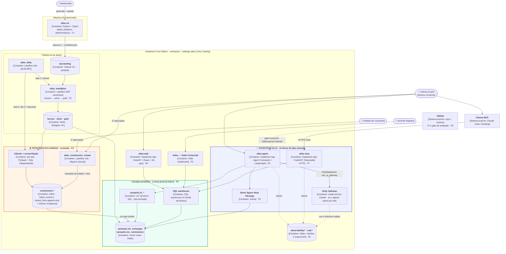
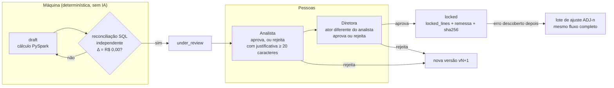

# Arquitetura — Atlas Recarga

> Spec: [SPEC-011](specs/011-architecture/spec.md) · Base: [PRD](prd.md) · Status: v1 (MVP), antes do Spike S0
> Este documento **resume** as specs, não as substitui. Se divergir de uma spec, vale a spec e este arquivo é corrigido.

## 1. Em uma frase

Um CLI gera dados sintéticos e os envia a um Volume; um pipeline declarativo os leva de bronze a gold; a comissão é calculada pela máquina mas **só é travada por duas pessoas**; e todos os consumidores (dashboards, agente de IA, MCP e app React) leem **uma única camada semântica**, sem acesso ao que está por baixo dela.

## 2. Diagrama de containers (C4 nível 2)

Caixas em linha cheia são containers; cilindros guardam dados; as duas fronteiras destacadas são o que este projeto quer provar.

**Como ler as setas:** cheia = dados ou comando; pontilhada = telemetria ou avaliação. Nenhuma seta sai da fronteira da IA em direção a `gold`, `commission` ou `atlas_commission_review`: essa ausência é a regra.

**Nada sai do workspace.** A remessa de comissão é um CSV num Volume; a malha do IBGE é baixada **no build** por `scripts/` e versionada; o pipeline nunca chama API externa ([tech-stack](specs/tech-stack.md), Proibido).

## 3. Onde ficam os dados

Tudo no catálogo `atlas` (no target `dev`, `atlas_dev`), um schema por camada e propósito ([ADR-0003](adr/0003-medallion-unity-catalog.md)).

| Schema | Guarda | Quem escreve | Quem lê |
|---|---|---|---|
| `raw` | Volume `landing/` com os arquivos do CLI (fonte imutável para full refresh) | `atlas-cli upload` (pede confirmação no harness) | `atlas_medallion` |
| `bronze` | Cópia fiel + `_source_file`, `_ingested_at_utc` | `atlas_medallion` | `atlas_medallion` |
| `silver` | Limpo, tipado, deduplicado; `recharges_quarantine` com os órfãos | `atlas_medallion` (expectations drop/fail/warn) | `atlas_medallion` |
| `gold` | `dim_*`, `fct_recharges`, `agg_pos_month`, com `COMMENT` em tudo | `atlas_medallion` | Cálculo de comissão; dono das metric views. **Nenhum consumidor** |
| `commission` | `batches`, `batch_lines`, `batch_events` e `locked_lines` (append-only), `reconciliation`, Volume `remittance/` | Task 2 do `atlas_daily` (rascunho) e `atlas_commission_review` (transições) | Analista e diretora pelo relatório `commission_review` (os grants de leitura ainda não estão definidos na SPEC-003); `mv_commission`, só sobre `locked_lines` + `batches` de lotes `locked` |
| `semantic` | Metric views `mv_recharges`, `mv_commission` e UC functions `fn_*` | Bundle, a partir de `semantic/*.yaml` | Grupo `atlas_readers`: Helena, gerentes e os service principals dos 3 Apps (SPEC-004 §7); o Genie Space consulta só as metric views |
| `eval` | `agent_golden_set` (sincronizado do YAML), `review_queue` | Script de sync e monitoramento (SPEC-008) | Avaliação offline, gate de PR, revisor humano |
| `observability` | `pipeline_freshness`, trace tables `agent_*` e `mcp_*`, `agent_quality_daily` | Task 3 do `atlas_daily`, MLflow, job de monitoramento | Páginas "Qualidade do agente" e "Uso do MCP" do AI/BI |

Fora do catálogo: experiments MLflow `/Shared/atlas/agent` e `/Shared/atlas/mcp`, a system table `system.query.history` (auditoria das queries do MCP) e a system table `system.ai_gateway.usage`, onde o Unity Gateway registra o uso do LLM.

## 4. Fronteira do humano: a comissão

O pagamento de comissão é a única etapa **irreversível** do negócio ([discovery](discovery.md)). Aqui a máquina calcula e confere; só pessoas decidem ([SPEC-003](specs/003-commission-closing/spec.md), [ADR-0010](adr/0010-commission-human-in-the-loop.md)).

A trava não depende de um só controle:

| Camada | O que impede |
|---|---|
| **Processo** | Duas aprovações com atores distintos (`SEGREGATION_OF_DUTIES_VIOLATION`); justificativa de ≥ 20 caracteres para rejeitar |
| **Dados** | `batch_events` e `locked_lines` com `delta.appendOnly`: o Delta rejeita `UPDATE`/`DELETE`; correção só por lote de ajuste |
| **Permissão UC** | Nenhum consumidor tem grant em `commission`; só lotes `locked` chegam à camada semântica |
| **Quem dispara** | `atlas_commission_review` é disparado manualmente por uma pessoa, e cada transição exige que o ator seja membro de `atlas_commission_analysts` ou `atlas_commission_directors`; nenhum agente, MCP ou app executa o job (SPEC-003 §4) |
| **Agente de código** | O hook do harness nega qualquer execução de `atlas_commission_review` ([SPEC-010](specs/010-agent-harness/spec.md) §3.3) |

**Concessão da Free Edition:** com um usuário só, `ALLOW_SAME_APPROVER_DEMO=true` permite o mesmo ator nas duas etapas, mas marca cada uso com `role = 'demo_override'` e o lote com `demo_mode = true` (SPEC-003 §9, Spike S0.6).

## 5. Fronteira da IA: só leitura

Há duas IAs no projeto, e as duas têm limites escritos.

**IA no produto** (agente e MCP, [SPEC-005](specs/005-business-agent/spec.md), [SPEC-006](specs/006-mcp-server/spec.md)). Gera valor ao responder em linguagem natural; gera risco ao inventar número ou agir. Por isso (a linha **Gateway** vale só para o agente; o MCP não passa pelo Unity Gateway, ver [ADR-0008](adr/0008-fastmcp-on-databricks-apps.md)):

| Camada | Controle | Verificado por |
|---|---|---|
| Ferramentas | Lista fechada: Genie e 3 UC functions no agente; 5 tools no MCP. Nenhuma de SQL livre, escrita ou execução de job | Scorer `read_only_tools` em 100% dos traces |
| Parâmetros | Medidas e dimensões validadas contra listas; valores como parâmetros vinculados | Teste de injeção (SPEC-006 §7) |
| Permissão UC | Nada fora de `atlas.semantic`: `SELECT` nas metric views, `EXECUTE` nas `fn_*` e `CAN RUN` no Genie Space (agente); o MCP usa o token do próprio usuário (on-behalf-of-user) ou, no plano B, um service principal só com `SELECT`. `PERMISSION_DENIED` em `gold` | Critério de aceite SPEC-004 §8 |
| Comportamento | Citação `Fonte:` obrigatória, nenhum número sem tool, recusa de ação e PII | Scorers `cites_metric_view`, `no_tool_on_refusal`, `refusal_quality` |
| Gateway (só agente) | Rate limit 30 req/min por usuário, teto de gasto, guardrail de PII ([ADR-0007](adr/0007-unity-gateway-llm-governance.md)) | `system.ai_gateway.usage` |
| Equivalente no MCP | O App não pode ser registrado no Unity Gateway, então faz o controle sozinho: 30 chamadas/min por usuário (`RATE_LIMITED`), span MLflow por tool só com atributos e auditoria por `system.query.history` ligada ao trace por `request_id`. Os controles de LLM não se aplicam: o MCP não chama LLM ([SPEC-006](specs/006-mcp-server/spec.md) §6) | Página "Uso do MCP" no AI/BI |
| Regressão | Gate de PR: acurácia ≥ 90% e 100% das recusas ([SPEC-008](specs/008-agent-evaluation/spec.md)) | `agent-eval.yml` |

A IA **não** participa do cálculo nem da aprovação de comissão, e não lê dado pessoal (o dataset nem tem PII real).

**IA na construção** (Claude Code, [SPEC-010](specs/010-agent-harness/spec.md), [ADR-0012](adr/0012-claude-code-harness.md)). Escreve código e abre PRs; não faz merge, não mexe na proteção da `main`, não faz deploy no target `demo` e não lê segredos. Três camadas: permissões do `.claude/settings.json`, hook `guard.py` e proteção de branch do GitHub ([ADR-0014](adr/0014-branch-protection-solo-maintainer.md)).

## 6. Componentes

| PRD | Componente | Onde roda | Repo | Spec · ADR |
|---|---|---|---|---|
| F1 | `atlas-cli` | Máquina do mantenedor | `cli/` | [SPEC-001](specs/001-synthetic-data-cli/spec.md) · [0011](adr/0011-deterministic-synthetic-cli.md), [0004](adr/0004-ibge-code-geojson-geo.md) |
| F2 | `atlas_medallion` + job `atlas_daily` | Lakeflow SDP + Jobs | `pipeline/` | [SPEC-002](specs/002-medallion-pipeline/spec.md) · [0002](adr/0002-lakeflow-declarative-pipelines.md), [0003](adr/0003-medallion-unity-catalog.md) |
| F3 | Cálculo, reconciliação e `atlas_commission_review` | Jobs | `commission/` | [SPEC-003](specs/003-commission-closing/spec.md) · [0010](adr/0010-commission-human-in-the-loop.md) |
| F4 | Metric views e UC functions | Unity Catalog + SQL warehouse | `semantic/` | [SPEC-004](specs/004-metric-views/spec.md) · [0005](adr/0005-metric-views-semantic-layer.md) |
| F5 | AI/BI Dashboard e Genie Space | Workspace | a definir (SPEC-004 não fixa) | [SPEC-004](specs/004-metric-views/spec.md) · [0005](adr/0005-metric-views-semantic-layer.md) |
| F6 | `atlas-agent` + Unity Gateway | Databricks App | `apps/agent/` | [SPEC-005](specs/005-business-agent/spec.md) · [0006](adr/0006-agent-framework-genie.md), [0007](adr/0007-unity-gateway-llm-governance.md) |
| F7 | `atlas-mcp` | Databricks App | `apps/mcp/` | [SPEC-006](specs/006-mcp-server/spec.md) · [0008](adr/0008-fastmcp-on-databricks-apps.md) |
| F8 | `atlas-web` | Databricks App | `apps/web/` | [SPEC-007](specs/007-react-geo-dashboard/spec.md) · [0004](adr/0004-ibge-code-geojson-geo.md), [0009](adr/0009-three-apps-allocation.md) |
| F9 | Golden set, scorers, gate e monitoramento | GitHub Actions + MLflow 3 | `eval/` | [SPEC-008](specs/008-agent-evaluation/spec.md) · [0013](adr/0013-mlflow-genai-evaluation-monitoring.md) |

Todos os recursos do workspace são declarados num Databricks Asset Bundle (`databricks.yml`, P5.1) com targets `dev` e `demo`.

## 7. Limites da Free Edition que moldam o desenho

| Limite ([ADR-0001](adr/0001-databricks-free-edition.md), salvo indicação) | Consequência no desenho |
|---|---|
| 1 SQL warehouse 2X-Small | Todos os consumidores dividem o mesmo warehouse: cache de 10 min no `atlas-web`, 1 nova tentativa após 20s no agente e no MCP, aviso de "aquecendo" na UI |
| 1 pipeline ativo por tipo | Um único `atlas_medallion` cobre bronze, silver e gold |
| 5 tasks de job concorrentes | Teto que os jobs do projeto respeitam: `atlas_daily` tem 3 tasks ([SPEC-002](specs/002-medallion-pipeline/spec.md) §2). Se o Spike S0.3 cair no plano B, entra o job `atlas_agent_monitoring` às 07:00 ([SPEC-008](specs/008-agent-evaluation/spec.md) §6) |
| Até 3 Apps, parados após 24h | Os 3 slots vão para agente, MCP e web, sem slot livre; runbook de start antes da demo ([ADR-0009](adr/0009-three-apps-allocation.md)) |
| Serving sem GPU, alguns modelos indisponíveis | O LLM é um model service Claude do Unity Gateway, com o nome exato confirmado no Spike S0.1 ([SPEC-005](specs/005-business-agent/spec.md) §2) |
| Possivelmente um único usuário (a confirmar no Spike S0.6) | Se confirmado, o modo demo de aprovação da comissão (seção 4) |

Os recursos em Beta (Unity Gateway como agent service, production monitoring do MLflow, OAuth de cliente MCP) são confirmados no Spike S0 (Fase 3) antes de qualquer código depender deles; cada um tem plano B escrito: Unity Gateway no ADR-0007, monitoramento no ADR-0013 e OAuth do MCP na SPEC-006 §5 (proxy `mcp-remote`).

## 8. Modos de falha

**Regra comum:** uma falha nunca vira número errado em silêncio. O gold anterior continua servido, o lote de comissão fica retido antes de qualquer humano, o agente diz que não conseguiu em vez de estimar e o mapa mantém os dados anteriores com um aviso. A tabela consolida o que as specs definem; o comportamento detalhado está na spec de cada linha.

### Dados (CLI e pipeline)

| Componente | O que quebra | Efeito | Detecção | Recuperação | Spec |
|---|---|---|---|---|---|
| `atlas-cli` | Referência IBGE ausente ou inválida | Nada é gerado | Código de saída `3` | Restaurar `data/reference/` e gerar de novo | [SPEC-001](specs/001-synthetic-data-cli/spec.md) §2 |
| `atlas-cli` | Upload para o Volume falha no meio | Parte dos arquivos no `landing/` | Código de saída `4` | Rodar `upload` de novo: é idempotente por sha256 | [SPEC-001](specs/001-synthetic-data-cli/spec.md) §3 |
| `atlas_medallion` | Arquivo do dia não chegou às 06:00 | O pipeline roda com o que existe; gold sem o dia | Task 3: `freshness_status = 'stale'` em `observability.pipeline_freshness` | **Lacuna:** a SPEC-002 não define a recuperação | [SPEC-002](specs/002-medallion-pipeline/spec.md) §4 |
| `atlas_medallion` | `expect_or_fail` violado (dimensão corrompida) | Pipeline falha; o **gold do dia anterior continua servido** | E-mail do job ao dono do workspace | **Lacuna:** a SPEC-002 não define a recuperação | [SPEC-002](specs/002-medallion-pipeline/spec.md) §4 |
| `atlas_medallion` | Mais de 1% de linhas descartadas no silver num dia | Gold publicado com menos linhas | Task 3: `quality_status = 'degraded'` | Não bloqueia no MVP; bloqueia na v2 | [SPEC-002](specs/002-medallion-pipeline/spec.md) §4 |
| `atlas_medallion` | Recarga com PDV inexistente | Linha fora do silver, **retida** | `silver.recharges_quarantine` | Ficam retidas para análise; **lacuna:** a SPEC-002 não define o reprocessamento | [SPEC-002](specs/002-medallion-pipeline/spec.md) §3 |
| `atlas_medallion` | Necessidade de reprocessamento total | — | — | Full refresh; o bronze é reconstruído do Volume (fonte imutável) | [SPEC-002](specs/002-medallion-pipeline/spec.md) §4 |

### Comissão (fronteira do humano)

| Componente | O que quebra | Efeito | Detecção | Recuperação | Spec |
|---|---|---|---|---|---|
| Reconciliação | Cálculo principal ≠ recálculo SQL independente, ou totais de controle que não batem | O lote **fica em `draft`**; nenhum humano o vê | `commission.reconciliation` sem `status = 'passed'` | Corrigir e recalcular | [SPEC-003](specs/003-commission-closing/spec.md) §4–§5 |
| `atlas_commission_review` | A mesma pessoa tenta as duas aprovações | A transição falha com `SEGREGATION_OF_DUTIES_VIOLATION` | Evento registrado em `batch_events` | Um ator diferente do analista faz a 2ª aprovação | [SPEC-003](specs/003-commission-closing/spec.md) §8–§9 |
| `atlas_commission_review` | Rejeição sem justificativa de ≥ 20 caracteres | A transição falha com `JUSTIFICATION_REQUIRED` | Erro do job | Reenviar com justificativa | [SPEC-003](specs/003-commission-closing/spec.md) §4 |
| Lote | Rejeitado por analista ou diretora | O lote não segue | Evento `rejected` em `batch_events` | Nova versão `vN+1` nasce em `draft` | [SPEC-003](specs/003-commission-closing/spec.md) §4 |
| `locked_lines`, `batch_events` | Tentativa de `UPDATE`/`DELETE` | O Delta rejeita (append-only) | Erro na operação | Nenhuma alteração possível: corrigir por lote de ajuste | [SPEC-003](specs/003-commission-closing/spec.md) §7–§8 |
| Lote `locked` | Erro descoberto depois do lock | O lote travado não muda | Revisão humana | Lote `COM-YYYY-MM-ADJ-n` pelo fluxo completo de aprovações | [SPEC-003](specs/003-commission-closing/spec.md) §7 |
| Remessa | Arquivo diferente do que foi travado | — | **Lacuna:** a igualdade do sha256 com `batches.remittance_sha256` é só critério de aceite; a SPEC-003 não diz quem compara nem quando | **Lacuna:** a SPEC-003 não define a recuperação | [SPEC-003](specs/003-commission-closing/spec.md) §6, §8 |

### Consumo (agente, MCP, web)

| Componente | O que quebra | Efeito | Detecção | Recuperação | Spec |
|---|---|---|---|---|---|
| SQL warehouse (compartilhado) | Parado (cold start) ou em timeout | Todos os consumidores esperam | Agente e MCP: falha na 1ª tentativa; web: espera > 3s | Agente e MCP tentam de novo após 20s e depois avisam (`WAREHOUSE_UNAVAILABLE` no MCP); web mostra "Aquecendo o banco de dados…" | [SPEC-005](specs/005-business-agent/spec.md) §6, [SPEC-006](specs/006-mcp-server/spec.md) §4, [SPEC-007](specs/007-react-geo-dashboard/spec.md) §4 |
| `atlas-agent` | Genie indisponível ou com timeout > 30s | Sem a tool principal | Timeout da tool | Usa a UC function equivalente; sem ela, "não consegui consultar agora", **nunca estima** | [SPEC-005](specs/005-business-agent/spec.md) §6 |
| `atlas-agent` | Rate limit (429) do Unity Gateway | Pergunta não respondida | Trace com `error_type = rate_limited` | "Limite de uso atingido, tente em 1 minuto" | [SPEC-005](specs/005-business-agent/spec.md) §6 |
| `atlas-mcp` | OAuth de cliente externo não funciona (Spike S0.5) | Claude não conecta direto | Spike S0.5 | Plano B: proxy local `mcp-remote` com token do `databricks auth`, nunca versionado | [SPEC-006](specs/006-mcp-server/spec.md) §5 |
| `atlas-mcp` | Medida, dimensão ou filtro fora da lista; `limit` acima do máximo; mês inválido | Nenhuma query executada | `INVALID_ARGUMENT` | O cliente corrige a chamada | [SPEC-006](specs/006-mcp-server/spec.md) §4 |
| `atlas-mcp` | Usuário sem `SELECT` na metric view | Sem dados | `PERMISSION_DENIED` | Conceder acesso ao grupo `atlas_readers` | [SPEC-006](specs/006-mcp-server/spec.md) §4 |
| `atlas-mcp` | Resultado com mais de 500 linhas | Sem dados | `RESULT_TOO_LARGE` | Agregar mais ou filtrar | [SPEC-006](specs/006-mcp-server/spec.md) §4 |
| `atlas-mcp` | Mais de 30 chamadas por minuto do mesmo usuário | Chamada recusada antes da query | `RATE_LIMITED`, com `retry_after_s` | Esperar `retry_after_s` | [SPEC-006](specs/006-mcp-server/spec.md) §4, §6 |
| `atlas-web` | API fora do ar ou com erro | **O mapa anterior é mantido** | Banner "Não foi possível carregar os dados (código)" | Botão de tentar de novo | [SPEC-007](specs/007-react-geo-dashboard/spec.md) §4 |
| `atlas-web` | `measure` fora da lista | Nenhuma consulta | HTTP 400 | — | [SPEC-007](specs/007-react-geo-dashboard/spec.md) §3 |
| `atlas-web` | Município da malha sem match em `municipality_ibge_code` de `dim_municipality` | Apareceria como "sem recargas" (hachurado), **mascarando o erro** | Teste automatizado entre a geometria e `dim_municipality` (critério de aceite) | **Lacuna:** a SPEC-007 não define a recuperação | [SPEC-007](specs/007-react-geo-dashboard/spec.md) §4, §6 |
| Os 3 Apps | Auto-stop após 24h | App fora do ar | Healthcheck do App | Runbook de demo `make apps-start`, que religa os 3 Apps e espera os healthchecks | [SPEC-005](specs/005-business-agent/spec.md) §6, [ADR-0009](adr/0009-three-apps-allocation.md) |

### Qualidade do agente

| Componente | O que quebra | Efeito | Detecção | Recuperação | Spec |
|---|---|---|---|---|---|
| Gate de PR | Acurácia < 90%, recusa falhando ou queda > 5 pontos | **O merge é bloqueado** | `agent-eval.yml` comenta no PR | Corrigir prompt, tool ou metric view | [SPEC-008](specs/008-agent-evaluation/spec.md) §5 |
| Produção | Média de 7 dias de `cites_metric_view` ou `read_only_tools` < 90% | Respostas sem fonte ou com tool indevida | SQL alert por e-mail ao dono | Investigar os traces; o caso vai para `review_queue` | [SPEC-008](specs/008-agent-evaluation/spec.md) §6 |
| Production monitoring | Beta indisponível na Free Edition | Sem avaliação contínua gerenciada | Spike S0.3 | Plano B: job `atlas_agent_monitoring` às 07:00 com os mesmos scorers | [SPEC-008](specs/008-agent-evaluation/spec.md) §6 |
