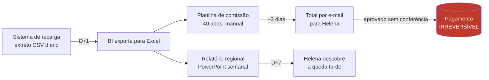

# Discovery — Atlas Recarga

> Status: **validado** · Última atualização: 2026-11-11
> Todos os nomes, empresas e números deste documento são fictícios. Nenhum dado real é usado no projeto.

## 1. Nomes do projeto

| Opção | Racional | Status |
|---|---|---|
| **Atlas Recarga** | Atlas é uma coleção de mapas e Recarga deixa o domínio explícito. O produto nasce do mapa. | **Escolhido** |
| Atlas PDV | Foca na rede de pontos de venda, onde moram a comissão e o risco. | Alternativa |
| Cartograma | Mapa em que a cor representa uma variável. Nome técnico e distintivo. | Alternativa |

## 2. O case

| Papel | Quem |
|---|---|
| **Negócio** | **Eaí? Telecom**: operadora móvel brasileira fictícia, cerca de 18 milhões de linhas, 82% pré-pagas. Forte no Norte, no Nordeste e no interior do Sudeste. |
| **Cliente (quem contratou)** | **Helena Duarte**, Diretora Comercial de Pré-Pago. 15 anos em telecom, responde pela receita de recarga e pela rede de canais indiretos. |
| **Usuários diários** | Helena (visão executiva e perguntas ad hoc) · **Analista de Comissões** (fecha e confere a comissão mensal) · **Gerentes Regionais** (acompanham a própria região no mapa) |
| **Produto** | **Atlas Recarga**: plataforma de dados e IA que mostra onde a recarga acontece, fecha a comissão da rede com segurança e responde a perguntas de negócio em linguagem natural. |

### Como a recarga chega ao cliente

```
Eaí? Telecom ──vende crédito──▶ Distribuidor (~40) ──repassa──▶ PDV (~5.000) ──vende recarga──▶ Assinante pré-pago
                                     │                              │
                                     └──── comissão mensal ◀────────┘
```

Os PDVs são bancas, farmácias, mercadinhos, lotéricas e apps parceiros. A comissão é o principal incentivo da rede: um PDV que recebe errado (a menos) para de vender, e um distribuidor que recebe a mais dificilmente devolve.

## 3. Entrevista simulada com a cliente

> Conversa imaginada para fundamentar o discovery. Eu faço os dois papéis.

**Eu:** Helena, o que te tira o sono hoje?

**Helena:** Duas coisas. A primeira é descobrir tarde que perdi uma região. No mês passado a recarga caiu 14% no oeste do Pará e eu só soube 9 dias depois, num relatório em PowerPoint. Quando fui ver, um concorrente tinha fechado acordo com dois distribuidores de lá.

**Eu:** E a segunda?

**Helena:** A comissão. Todo começo de mês minha analista passa uns três dias numa planilha de 40 abas cruzando o extrato de recargas com a tabela de faixas. Em março pagamos R$ 212 mil a mais para um distribuidor por causa de uma fórmula arrastada errado. Recuperar isso levou quatro meses e desgastou a parceria. Pagamento feito não volta com um Ctrl+Z.

**Eu:** Como você responde a uma pergunta como "qual o ticket médio no interior de Pernambuco"?

**Helena:** Mando para o time de BI e espero de dois a cinco dias. Muitas vezes o número que volta não bate com o que o financeiro tem, porque cada um calcula "receita" de um jeito.

**Eu:** O que você gostaria de ter?

**Helena:** Um mapa do Brasil em que eu bata o olho e veja onde está forte e onde está fraco, clicar no estado e ver os municípios. E poder perguntar em português e receber um número em que eu confie.

**Eu:** E do que você tem medo nessa história de IA?

**Helena:** De ela inventar. Se o assistente me disser que o Ceará cresceu 8% e na verdade caiu, e eu levo isso para o comitê, minha credibilidade acabou. Não quero que IA nenhuma mexa em comissão. Quero que ela me ajude a ver, não que decida por mim.

**Eu:** Quem precisa aprovar a comissão antes de ela ser paga?

**Helena:** Hoje sou eu, olhando o total no e-mail. Na prática ninguém confere linha a linha. Eu queria que alguém conferisse de verdade, com as divergências na frente, e que ficasse registrado quem aprovou.

## 4. O problema

**A Eaí? Telecom não tem uma visão confiável, atual e geográfica da sua rede de recarga, e fecha a comissão de canal num processo manual e sem trilha de auditoria, em que um erro é financeiramente irreversível.**

### Quem sofre e como

| Quem | Dor | Custo hoje (fictício) |
|---|---|---|
| Helena | Descobre quedas regionais com D+7 a D+10 | Perda de share regional antes de reagir |
| Helena | Perguntas ad hoc levam dias e voltam com números divergentes | Decisão tomada com dado velho ou errado |
| Analista de Comissões | ~3 dias por mês em planilha, cálculo frágil | ~24h de trabalho manual por mês |
| Financeiro | Pagamento indevido, recuperação lenta | R$ 212 mil pagos a mais num único mês |
| Distribuidores e PDVs | Recebem errado ou atrasado | Atrito com o canal e risco de migração para concorrente |

### Como é resolvido hoje



### Onde dói mais

1. **Pagamento de comissão (irreversível).** É a etapa onde errar custa caro. Hoje não há validação automática, reconciliação nem registro de quem aprovou.
2. **Latência da informação regional.** A queda só aparece quando já é tarde para reagir.
3. **Divergência de definições.** "Receita", "PDV ativo" e "ticket médio" têm uma fórmula por área.
4. **Dependência do time de BI** para qualquer pergunta nova.

## 5. O que é irreversível e quem aprova

| Etapa | Reversível? | Quem decide | Papel da IA |
|---|---|---|---|
| Gerar e ingerir dados | Sim (reprocessável) | Pipeline automático | Nenhum |
| Calcular a comissão (rascunho) | Sim (recalculável) | Pipeline automático | Nenhum |
| **Aprovar o lote de comissão** | **Não. Vira pagamento.** | **Analista de Comissões aprova e Helena dá o aval final** | **Proibida.** A IA não escreve, não aprova e não altera nada. |
| Responder pergunta de negócio | Sim, mas o dano reputacional é real | Agente, com guardrails | Leitura apenas, via camada semântica, citando a fonte |

> No projeto, o "pagamento" é **simulado**: um lote aprovado vira `locked` e gera um arquivo de remessa fictício. Nada sai do ambiente.

## 6. Onde a IA gera valor e onde gera risco

| | Valor | Risco | Mitigação |
|---|---|---|---|
| **Agente de perguntas** | Resposta em minutos em vez de dias, sem depender do BI | Alucinar número, usar definição errada, **piorar em silêncio** após uma mudança de prompt, de modelo ou de metric view | Só consulta **metric views** (definição única), cita a view e o filtro usados, recusa o que está fora do escopo. **Avaliação offline** contra o golden set antes de cada mudança e **monitoramento em produção** dos traces |
| **MCP no Claude** | Helena pergunta de onde já trabalha | Acesso amplo demais aos dados | Tools somente leitura, escopo restrito às metric views, auth via Databricks |
| **Comissão** | Nenhum no MVP (deliberado) | IA decidir pagamento | **Fora de escopo por design.** Cálculo determinístico e aprovação humana. |
| **Forecast (v2)** | Metas regionais mais realistas | Meta irreal desmotiva o canal | Adiado até haver histórico e backtesting |

## 7. Hipóteses a validar

| # | Hipótese | Como validar no MVP |
|---|---|---|
| H1 | Uma camada semântica única elimina a divergência de números | O agente, o AI/BI e o React retornam o mesmo valor para a mesma pergunta |
| H2 | O mapa coroplético revela quedas regionais mais rápido que o relatório | Anomalias injetadas pelo CLI aparecem visualmente no D+1 |
| H3 | O fechamento automatizado com revisão humana elimina o erro de comissão | 0 divergência entre o cálculo e a reconciliação independente em todos os lotes |
| H4 | O agente restrito a metric views tem acurácia suficiente para uso executivo **e mantém essa acurácia ao longo do tempo** | ≥90% no golden set de cerca de 30 perguntas (avaliação offline, que bloqueia o PR) **e** monitoramento contínuo dos traces em uso, que detecta queda de qualidade (ver PRD F9) |

## 8. Restrições do projeto

- **Dados 100% sintéticos**, gerados por um CLI com seed determinística. Geografia baseada em códigos e malhas públicas do IBGE.
- **Nenhum efeito externo**: sem pagamento, sem envio a terceiros, sem documento com validade.
- **Plataforma: Databricks Free Edition.** Limites relevantes: 1 SQL warehouse 2X-Small, 1 pipeline Lakeflow ativo por tipo, até 3 Apps (param após 24h), serving sem GPU.

## 9. Perguntas resolvidas na validação (2026-11-11)

- Faixas de comissão (distribuidor 3%, PDV de 2% a 5% por volume): **aprovadas** → SPEC-003.
- DDD como dimensão, além de UF e município: **incluído** → SPEC-004.
- Frescor D-1 até 08:00: **suficiente para o MVP**.
