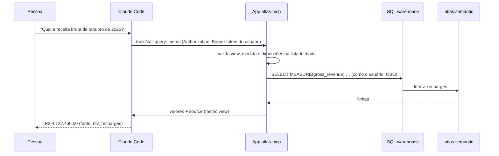
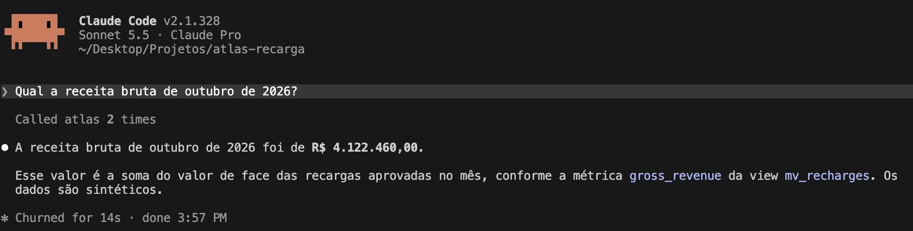

# Usar o Atlas Recarga no Claude Code (MCP)

Como o Claude Code conversa com o App `atlas-mcp` e o que acontece em cada passo. Governado pela [SPEC-006](specs/006-mcp-server/spec.md) §5 e pelo [ADR-0008](adr/0008-fastmcp-on-databricks-apps.md). Entregue na P11.5.

## O que é

O `atlas-mcp` é um servidor [MCP](https://modelcontextprotocol.io) (FastMCP, Streamable HTTP em `/mcp`) hospedado como Databricks App. Ele expõe cinco tools **somente leitura**: `health`, `list_metrics`, `query_metric`, `top_regions` e `compare_months`. Todas leem só `atlas.semantic` (as metric views), com listas fechadas e parâmetros vinculados: nenhum SQL livre, nenhuma métrica calculada fora da metric view (princípios da [mission](specs/mission.md)).

O Claude Code é o cliente: ele descobre as tools, escolhe qual chamar e redige a resposta. **Quem calcula o número é a metric view**; o Claude só o repassa com a fonte.



## Como conectar

Pré-requisitos: o App `atlas-mcp` está `RUNNING` (ele para sozinho após 24 h; ver o runbook da P13.1), você tem `SELECT` em `atlas.semantic` e a CLI do Databricks autenticada num profile.

```bash
# 1. URL do App
databricks apps get atlas-mcp --profile <profile> -o json | jq -r .url

# 2. Token de curta duração do seu usuário, só na sua sessão de shell
export DATABRICKS_USER_TOKEN=<token OAuth do seu usuário, gerado pela CLI do Databricks>

# 3. Registrar o servidor no Claude Code
claude mcp add --transport http atlas https://<atlas-mcp-app-host>/mcp \
  --header "Authorization: Bearer $DATABRICKS_USER_TOKEN"
```

Depois, no Claude Code, `/mcp` deve mostrar `atlas` conectado. Pergunte em linguagem natural, por exemplo: *"Qual a receita bruta de outubro de 2026?"*. A resposta traz o valor e a `source` (a metric view).

### Por que não o login pelo navegador (OAuth interativo)

Foi tentado na P11.5 e **falha**: o Claude Code se apresenta ao Databricks como um client público (`https://claude.ai/oauth/claude-code-client-metadata`), que não está registrado no workspace. O Databricks nega os scopes que o App pede:

```
access_denied: Scopes 'iam.access-control:read iam.current-user:read sql' are not
assigned to the client https://claude.ai/oauth/claude-code-client-metadata
```

Registrar o client exigiria uma OAuth app connection no console de conta, que a Free Edition não oferece. Por isso o caminho documentado é o **token de usuário no cabeçalho**, que o Spike S0.5 já tinha validado.

### Cuidados

- **O token expira** (cerca de 1 hora). Quando as tools passarem a falhar com erro de autenticação, gere outro token e repita os passos 2 e 3 (`claude mcp remove atlas` antes).
- **`--header` grava o token em texto puro** no `~/.claude.json`, que fica na sua máquina e fora do repositório. Nunca cole o token em arquivo versionado, issue ou PR. Em máquina compartilhada, remova o servidor ao terminar: `claude mcp remove atlas`.
- **Alternativa com proxy:** `claude mcp add atlas -- npx -y mcp-remote <url>/mcp --header "Authorization: Bearer ${DATABRICKS_USER_TOKEN}"` (o `mcp-remote` é o plano B original da SPEC-006 §5). O resultado é o mesmo.

## Segurança e auditoria

| Garantia | Como se verifica |
|---|---|
| Só leitura | O servidor não tem tool de escrita; `query_metric` aceita só nomes da lista fechada (`catalog.json`, gerado de `semantic/*.yaml`) e vincula todo valor como parâmetro |
| Roda como você | Modo on-behalf-of-user: `system.query.history.executed_by` é o seu usuário, e quem não tem `SELECT` em `atlas.semantic` recebe `PERMISSION_DENIED` |
| Rastreável | Cada chamada gera um trace em `/Shared/atlas/mcp` (só atributos, sem valores) e o SQL leva o comentário `/* atlas-mcp request_id=… */`, o mesmo `request_id` do trace |
| Limite de uso | 30 chamadas por minuto por usuário; a 31ª recebe `RATE_LIMITED` sem rodar query |

## Evidência (P11.5, 2026-11-19)

Claude Code v2.1.328 conectado ao `atlas-mcp` no `dev`. A pergunta "Qual a receita bruta de outubro de 2026?" chamou o servidor `atlas` (2 chamadas: a descoberta da métrica e a consulta) e devolveu **R$ 4.122.460,00**, citando a métrica `gross_revenue` da view `mv_recharges`. É o mesmo valor do gold, do AI/BI e do GS-001 do golden set.



**Não conferido nesta task:** `executed_by` na `system.query.history` para esta sessão (o S0.5 e a P11.4 já o conferiram com o mesmo tipo de token), as duas chamadas individualmente (a captura mostra só "Called atlas 2 times") e o OAuth interativo, que falha pelo motivo acima.
