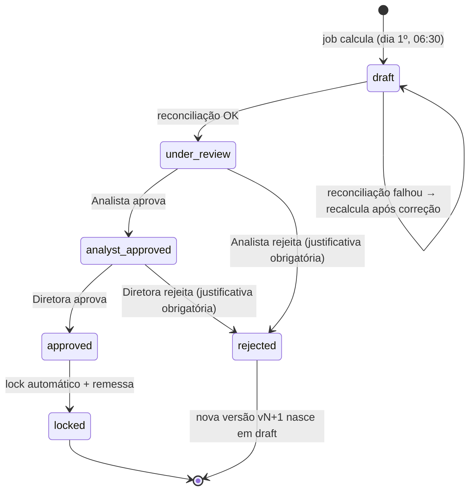

# SPEC-003 — Fechamento de comissão

> PRD: F3 · ADR: [0010](../../adr/0010-commission-human-in-the-loop.md) · Status: rascunho
> **Etapa crítica do produto.** O pagamento é irreversível no mundo real. No projeto ele é simulado (remessa em arquivo), mas o processo é tratado como se fosse real.

## 1. Objetivo
Calcular a comissão mensal de PDVs e distribuidores de forma **determinística e reconciliada**, submeter o resultado a **duas aprovações humanas** e, depois de aprovado, **travar o lote de forma imutável**, gerando a remessa simulada.

## 2. Regras de cálculo (aprovadas na validação de 2026-11-11)

Base: `gold.agg_pos_month.approved_amount_brl`, ou seja, só recargas `approved` do mês civil. Recargas `reversed` não contam.

**PDV, por faixa de volume mensal (a faixa inteira, não progressiva):**

| Faixa | Volume aprovado no mês (R$) | Taxa |
|---|---|---|
| Bronze | `< 5.000,00` | 2% |
| Prata | `5.000,00` a `19.999,99` | 3% |
| Ouro | `20.000,00` a `49.999,99` | 4% |
| Diamante | `≥ 50.000,00` | 5% |

**Distribuidor:** 3% sobre a soma do volume aprovado de todos os seus PDVs no mês.

**Arredondamento:** cada linha é arredondada para centavos com `ROUND_HALF_EVEN`. O total do lote é a **soma das linhas já arredondadas**, nunca o total recalculado.

PDV fechado no meio do mês recebe sobre o volume até `closed_date`. PDV com volume zero não gera linha.

## 3. Modelo de dados (`atlas.commission`)

| Tabela | Propriedades | Conteúdo |
|---|---|---|
| `batches` | | `batch_id` (`COM-YYYY-MM-vN`), `reference_month`, `version`, `status`, `total_pos_brl`, `total_distributor_brl`, `source_snapshot_version` (versão Delta do gold usada), `remittance_sha256`, `demo_mode` (BOOLEAN NOT NULL, sempre informado: `false` no fluxo normal; ver §9), `created_at_utc` |
| `batch_lines` | | Linhas de rascunho: `batch_id`, `beneficiary_type` (`pos`\|`distributor`), `beneficiary_id`, `base_amount_brl`, `tier`, `rate`, `commission_brl`, `flags` (array) |
| `batch_events` | `delta.appendOnly = true` | Trilha de auditoria: `event_id`, `batch_id`, `from_status`, `to_status`, `actor` (`current_user()`), `role`, `justification`, `event_ts_utc` |
| `locked_lines` | `delta.appendOnly = true` | Cópia das linhas no momento do lock. **Fonte oficial** para a metric view de comissão |
| `reconciliation` | | Resultado da reconciliação por lote (seção 5) |

## 4. Máquina de estados

| Transição | Quem | Pré-condições |
|---|---|---|
| `draft → under_review` | Sistema | Reconciliação com `status = 'passed'` |
| `under_review → analyst_approved` | Membro de `atlas_commission_analysts` | Ter visualizado o relatório de reconciliação e os flags |
| `analyst_approved → approved` | Membro de `atlas_commission_directors` | **Ator diferente do analista** (segregação de funções) |
| `* → rejected` | Analista ou diretora | `justification` com ≥ 20 caracteres |
| `approved → locked` | Sistema | Copia para `locked_lines`, gera a remessa e grava o sha256 |

**As transições são executadas pelo job parametrizado `atlas_commission_review`** (`batch_id`, `decision`, `justification`), disparado manualmente por uma pessoa. Nenhum agente, MCP ou app tem permissão de executar esse job (ver SPEC-005 §4 e ADR-0010).

## 5. Reconciliação (antes de qualquer humano ver o lote)

1. **Duas implementações independentes:** o cálculo principal em PySpark e um recálculo em SQL puro sobre `gold.fct_recharges`, sem passar por `agg_pos_month`. A diferença por linha e no total deve ser **R$ 0,00**.
2. **Totais de controle:** a soma de `base_amount_brl` das linhas de PDV é igual ao volume aprovado do mês em `fct_recharges`, e a soma dos distribuidores bate com a soma por distribuidor.
3. **Flags para revisão humana** (não bloqueiam; ficam destacados no relatório):
   - `spike_3x`: comissão do PDV > 3× a média dos 3 meses anteriores.
   - `fractioning_suspect`: mais de 20 recargas de R$ 10 ao mesmo `subscriber_id` em < 10 min.
   - `tier_jump`: subiu 2 ou mais faixas em relação ao mês anterior.
   - `closed_pos`: PDV fechado no mês.
4. O relatório é um notebook/dashboard `commission_review` por `batch_id`, com totais, top 20 maiores linhas, linhas com flag e comparação com o mês anterior.

## 6. Remessa simulada
`/Volumes/atlas/commission/remittance/<batch_id>.csv` (`beneficiary_type, beneficiary_id, commission_brl`) + `<batch_id>.sha256`. **Nada é enviado para fora do workspace.**

## 7. Correção depois do lock
Um lote `locked` nunca é alterado. Um erro descoberto depois gera um **lote de ajuste** `COM-YYYY-MM-ADJ-n` com linhas de diferença (positivas ou negativas), que passa pelo mesmo fluxo completo de estados e aprovações.

## 8. Critérios de aceite
- **Dado** o dataset padrão, **quando** o rascunho é calculado, **então** a reconciliação dá diferença R$ 0,00 em 100% das linhas.
- **Dado** um PDV com R$ 4.999,99, **então** fica em Bronze com 2% (R$ 100,00); **dado** R$ 5.000,00, **então** fica em Prata com 3% (R$ 150,00).
- **Dado** o cenário `fractioning`, **então** os 3 PDVs aparecem com `fractioning_suspect`.
- **Dado** um lote `under_review`, **quando** a mesma pessoa tenta aprovar como analista e como diretora, **então** a segunda transição falha com `SEGREGATION_OF_DUTIES_VIOLATION` e é registrada em `batch_events`.
- **Dado** um lote `locked`, **quando** qualquer processo tenta um `UPDATE` ou `DELETE` em `locked_lines` ou `batch_events`, **então** o Delta rejeita a operação (append-only).
- **Dado** uma rejeição sem justificativa, **então** a transição falha com `JUSTIFICATION_REQUIRED`.
- **Dado** um lote `locked`, **então** o sha256 da remessa no Volume é igual a `batches.remittance_sha256`.
- **Dado** todos os lotes `locked`, **então** 100% têm 2 eventos de aprovação com atores distintos (métrica do PRD).

## 9. Modo demo (Free Edition)
O Spike S0.6 mostrou que a Free Edition aceita um segundo usuário e grupos `atlas_*` criados por nós; portanto a segregação de funções (dois atores distintos) é o padrão. Ainda **não exercida**: o S0.6 só inferiu as duas identidades, e a segregação depende dos grupos `atlas_commission_*`, criados na P5.2. Como **contingência explícita** (por exemplo, o segundo usuário indisponível), a variável de job `ALLOW_SAME_APPROVER_DEMO=true` permite o mesmo ator nas duas etapas. Cada uso grava `role = 'demo_override'` em `batch_events` e o lote fica marcado `demo_mode = true`. Isso nunca é o comportamento padrão.

## 10. Fora de escopo
IA no cálculo ou na aprovação (nunca), UI de aprovação no React (v2), pagamento real (nunca), metas e bônus (v2, junto com o forecast).
